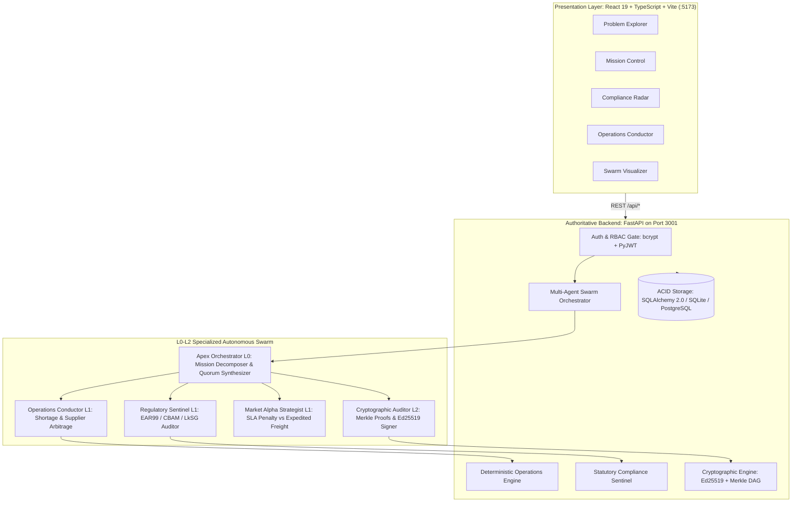
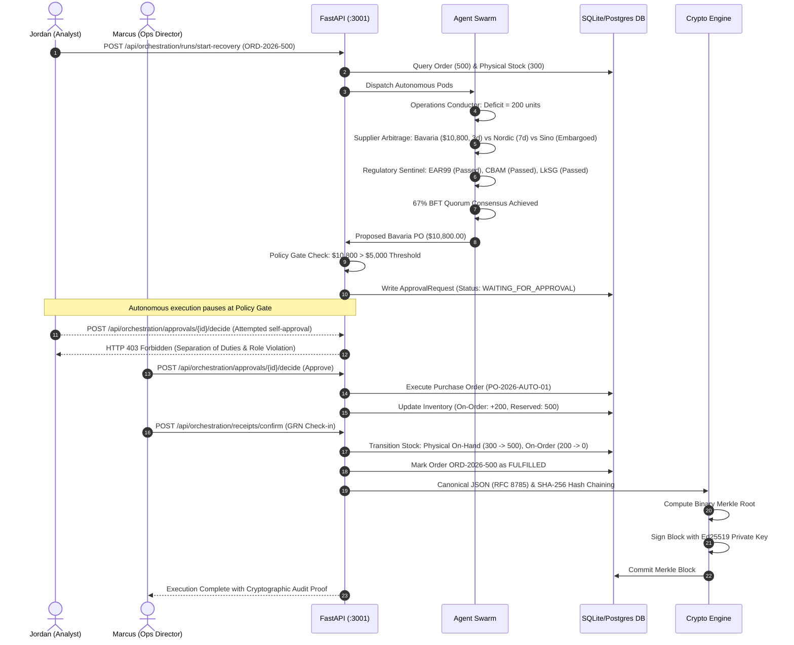

# AETHERIS AEOS — Comprehensive Solution Workflow & Operational Manual

> **System Designation:** AETHERIS AEOS (Autonomous Enterprise Operating System)  
> **Release Version:** 2.6.4 (Production Architecture)  
> **Authoritative Ports:** FastAPI Backend `:3001` | React 19 Client `:5173`  
> **Audited Date:** October 2026  
> **Security Baseline:** Four-Eyes Principle, Ed25519 Asymmetric Signatures, SHA-256 Merkle DAG, BFT Swarm Quorum  

---

## 1. Executive Summary & Problem-Solution Mapping

### 1.1 The Enterprise Problem Statement: "The Scale Asymmetry"
Modern mid-market enterprises and industrial original equipment manufacturers (OEMs) operate under severe structural disadvantages compared to multinational defense and aerospace conglomerates:

1. **The "Automate Everything" Trap (Over-scoping & Fragility):** 80%+ of enterprise AI pilots fail before production because organizations attempt monolithic, all-or-nothing automation without bounded context or deterministic validation.
2. **Fragmented Data & Legacy ERP Latency:** Over 68% of enterprise operational records reside in siloed on-premise systems (legacy SAP, QuickBooks, Odoo). Batch processing updates take 12 to 36 hours, making real-time disruption mitigation impossible.
3. **Statutory Regulatory Exposure:** Operating across jurisdictions exposes businesses to severe statutory liabilities:
   - **US EAR99 (15 CFR § 734):** Strict dual-use aerospace export controls and OFAC SDN sanctions.
   - **EU CBAM (Regulation 2023/956):** Carbon Border Adjustment Mechanism carbon tariff calculations per metric ton.
   - **German Supply Chain Due Diligence Act (LkSG § 3):** Human rights and environmental vendor vetting.
4. **Capital & Resource Disparity:** Regional firms operate with 1/10th the budget of global players and have zero dedicated machine learning infrastructure.
5. **The Trust & Accountability Deficit:** 92% of business executives refuse to entrust black-box autonomous AI with binding commercial contracts or capital expenditures without human-in-the-loop (HITL) authorization and cryptographic proof.

### 1.2 The Canonical Benchmark Challenge: Order `ORD-2026-500`
- **Customer:** Airbus Defense & Space.
- **Product Requirement:** 500 units of Titanium Grade 5 Aerospace Flanges (`TF-700`).
- **Required SLA Deadline:** Maximum 5 business days (Late delivery incurs contractual penalties of $2,500/day).
- **Physical On-Hand Inventory:** 300 units located in Central Munich Logistics Hub (`FRA-01`).
- **Deficit:** Acute shortage of **200 units** ($500 - 300 = 200$).
- **The Breakdown Risk:** Legacy ERP discovery latency causes a 3-day response delay, incurring $7,500 in SLA penalties, risking customs seizure for missing export licenses, and committing to suppliers with unverified carbon tariffs.

---

## 2. End-to-End Solution Workflow Architecture

AETHERIS AEOS replaces passive ERP dashboards with an **active, backend-driven, deterministic multi-agent operating system**.



### 2.1 The 8-Stage Operational Execution Lifecycle



---

## 3. Comprehensive Feature Catalog & Underlying Technologies

| Category | Feature Name | Core Functionality | Underlying Technologies & Libraries | Architectural Significance |
| :--- | :--- | :--- | :--- | :--- |
| **Authentication & RBAC** | Multi-Tenant Zero-Trust RBAC | Role-based token authentication enforcing least privilege across 4 tiers: `executive`, `operations_director`, `compliance_officer`, `analyst`. | Python `bcrypt`, `PyJWT`, FastAPI `Depends()`, React Context (`AuthContext.tsx`). | Prevents unauthorized financial actions and logs all privilege violations to the audit chain. |
| **Authentication & RBAC** | Four-Eyes Principle (Dual Custody) | Prevents the user who initiated the procurement recovery run from approving their own high-value purchase order. | FastAPI request dependency checking `run.initiated_by_user_id != approver.id`. | Eliminates rogue internal spend and fraud in accordance with enterprise SOX/defense standards. |
| **Autonomous Swarm** | Apex Orchestrator (L0) | Decomposes macro operational directives into bounded task graphs, arbitrates agent recommendations, synthesizes BFT consensus. | Python 3.11+, AsyncIO, Pydantic 2.0 schemas, Google Gemini 2.5/1.5 Flash API. | Provides master task coordination without single-point agent failure. |
| **Autonomous Swarm** | Operations Conductor (L1) | Calculates deterministic inventory deficit ($500 - 300 = 200$) and performs multi-vendor supplier scoring across lead time, price, and quality. | Python arithmetic, SQLAlchemy relational queries, deterministic ranking matrix. | Replaces LLM guessing with exact, verifiable mathematical optimization. |
| **Autonomous Swarm** | Regulatory Sentinel (L1) | Checks suppliers and parts against US EAR99, EU CBAM carbon border tariffs, and German LkSG human rights acts with exact statutory citations. | Relational `ComplianceDocument` store, statutory excerpt parser, rule engine. | Guarantees compliance-by-design before purchase commitments are created. |
| **Autonomous Swarm** | Market Alpha Strategist (L1) | Calculates contractual delivery SLA late penalty curves vs expedited freight cost to optimize net financial EBITDA. | Deterministic financial arbitrage utility functions, pricing sensitivity models. | Protects corporate margins during global supply chain disruptions. |
| **Autonomous Swarm** | Byzantine Fault Tolerant Consensus | Aggregates individual agent votes (APPROVE, CONDITIONAL, REJECT) with confidence weights requiring a 67% supermajority quorum. | Python weighted quorum engine, veto rule enforcement for compliance agent. | Prevents rogue or compromised agents from forcing invalid actions. |
| **Governance & Policy** | Autonomous Spending Ceiling Gate | Halts autonomous purchase order execution into `waiting_for_approval` if total procurement cost exceeds `$5,000.00`. | FastAPI policy interceptor, `ApprovalRequest` entity in SQLAlchemy. | Hard fiduciary boundary ensuring corporate capital safety. |
| **Supply Chain Semantics** | 4-Stage Inventory Lifecycle | Discretely tracks `quantity_on_hand` (300), `on_order_quantity` (200), and `reserved_quantity` (500). Distinguishes PO execution from physical receipt. | SQLAlchemy 2.0 transaction isolation, ACID database triggers. | Eliminates semantic errors where placing a PO was falsely assumed to mean goods immediately arrived. |
| **Supply Chain Semantics** | Goods Receipt Note (GRN) Confirmation | Formal endpoint `/api/orchestration/receipts/confirm` simulating physical warehouse arrival, transitioning parts from on-order to on-hand. | FastAPI REST route, atomic relational transactions, warehouse audit logging. | Models actual physical logistics delivery and receipt before marking customer orders fulfilled. |
| **Cryptography & Ledger** | RFC 8785 Canonical JSON | Standardizes state transformation payloads with sorted dictionary keys, compact separators, and UTF-8 encoding. | Python `json.dumps(..., sort_keys=True, separators=(',', ':'))`. | Guarantees deterministic SHA-256 hash digests across diverse operating environments. |
| **Cryptography & Ledger** | SHA-256 Event Chaining | Links every task and approval event to the SHA-256 hash of its immediate predecessor: $H_n = \text{SHA256}(H_{n-1} \parallel \text{event}_n)$. | Python `hashlib.sha256`. | Guarantees continuous audit trail integrity; tampering with row $k$ breaks all descending hashes. |
| **Cryptography & Ledger** | Binary Merkle Tree Engine | Organizes run events into balanced binary Merkle trees with duplication of odd nodes. Computes Merkle root $R$. | Custom binary tree engine in `server_py/crypto_engine.py`. | Enables mathematical proofs of inclusion in $O(\log N)$ time. |
| **Cryptography & Ledger** | Ed25519 Asymmetric Digital Signing | Signs the sealed Merkle block root using an attested security auditor private key with Ed25519 curves. | Python `cryptography.hazmat.primitives.asymmetric.ed25519`. | Provides cryptographic non-repudiation and external third-party verification without blockchain overhead. |
| **Cryptography & Ledger** | Mathematical Inclusion Proofs | Generates minimal sibling hash paths `[(hash, 'left'/'right')]` that client inspectors re-hash to verify state presence. | FastAPI verification endpoint `/api/orchestration/merkle/verify/{block}`. | Empowers external auditors to independently verify transactions in milliseconds. |
| **Frontend Presentation** | Problem Statement Explorer | Quantifies legacy ERP fragility, models the 5 "Ps" of enterprise failure, features interactive ROI sliders across 4 sectors. | React 19, TypeScript, Lucide Icons, Vanilla CSS design tokens. | Educates executives on why multi-agent systems are necessary. |
| **Frontend Presentation** | Swarm Visualizer | Dynamic SVG node graph illustrating live agent inter-communication, message bus, task dispatch queues, and voting states. | SVG canvas, React state transitions, CSS keyframe animations. | Provides visual transparency into multi-agent coordination. |
| **Frontend Presentation** | Mission Control Cockpit | The central command desk: run initiation, real-time timeline, agent thought streams, consensus voting matrix, and block sealing telemetry. | React 19 hooks (`useCallback`, `useState`, `useEffect`), Lucide icons, Vite proxy. | Enables continuous situational awareness and one-click execution. |
| **Frontend Presentation** | Regulatory Compliance Radar | Visualizes statutory compliance across EAR99, EU CBAM, and German LkSG with real-time excerpt citations and certificate status badges. | CSS grid cards, certificate modal inspection, filter toggles. | Eliminates legal blind spots in global procurement. |
| **Frontend Presentation** | Operations Conductor Desk | Real-time warehouse inventory, supplier bidding comparison grids, PO progression, goods receipt notes, and approval queues. | React components, styled comparison tables, status badge components. | Tactical workbench for supply chain directors. |
| **Frontend Presentation** | Command Palette (`Ctrl+K`) | Omnipresent shortcut modal for instant view switching, recovery mission triggering, and parts catalog search. | React portals, keyboard event listeners (`keydown`), fuzzy filter. | Power-user navigation for rapid incident response. |
| **Frontend Presentation** | Audit Proof Inspector Modal | Visualizes Merkle tree paths, sibling hashes, payload canonical strings, and Ed25519 public key verification status. | React modal portal, monospace typography, copyable cryptographic digests. | Demonstrates audit proof transparency directly in the browser. |
| **Frontend Presentation** | Dual Theme Engine | Supports *Linear Dark Obsidian* (default) and *Apple Light Studio* themes with dynamic CSS variable injection. | CSS root variables, `localStorage` persistence, theme toggle switcher. | World-class aesthetic presentation meeting high executive standards. |

---

## 4. Step-by-Step Operational Guide (How to Operate AEOS)

### 4.1 System Prerequisites & Installation
Ensure you have the following environments installed on your machine:
- **Node.js**: v18.0.0 or higher (v20+ recommended).
- **Python**: v3.10 or higher (Python 3.11–3.14 fully supported).
- **Package Managers**: `npm` and `pip`.

#### Installation Commands:
```bash
# Navigate to the project directory
cd "d:\DEVLOPEMENT\2nd project\2nd project"

# Install frontend dependencies
npm install

# Install backend Python dependencies
pip install fastapi uvicorn sqlalchemy cryptography bcrypt pydantic
```

---

### 4.2 Starting the Servers

#### Option A: One-Command Concurrent Launch (Recommended)
From the project root:
```bash
npm run dev:all
```
*This starts both the FastAPI backend on port `3001` and Vite frontend on port `5173` concurrently.*

#### Option B: Manual Two-Terminal Launch
**Terminal 1 — Authoritative FastAPI Backend:**
```bash
cd "d:\DEVLOPEMENT\2nd project\2nd project"
python -m uvicorn server_py.main:app --host 0.0.0.0 --port 3001 --reload
```
*Verifiable at: http://localhost:3001/api/health*

**Terminal 2 — React 19 Frontend:**
```bash
cd "d:\DEVLOPEMENT\2nd project\2nd project"
npm run dev
```
*Verifiable at: http://localhost:5173*

---

### 4.3 Default Enterprise Personas & Credentials

The database is seeded automatically with four distinct enterprise roles:

| Persona Title | Full Name | Email Address | Password | Operational Capabilities |
| :--- | :--- | :--- | :--- | :--- |
| **Executive (COO)** | Elena Rostova | `elena@aetheris.ai` | `Executive2026!` | Full oversight, unlimited approval ceiling, audit export, system config. |
| **Operations Director** | Marcus Vance | `marcus@aetheris.ai` | `Operations2026!` | Supply chain lead, PO approval (&gt;$5k), Goods Receipt (GRN) confirmation. |
| **Compliance Officer** | Sophia Chen | `sophia@aetheris.ai` | `Compliance2026!` | Regulatory radar lead, statutory excerpt auditor. (PO approval denied). |
| **Supply Chain Analyst** | Jordan Taylor | `jordan@aetheris.ai` | `Analyst2026!` | Shortage detector, recovery initiator. (PO approval denied with HTTP 403). |

---

### 4.4 End-to-End Operational Walkthrough: The Airbus Benchmark

Follow these exact steps to observe the end-to-end solution workflow in action:

#### Phase 1: Sign In & Explore Problem Context
1. Open your browser to `http://localhost:5173`.
2. On the **Login Page**, click the quick-select button **"Analyst (Jordan)"** to populate the credentials (`jordan@aetheris.ai` / `Analyst2026!`).
3. Click **"Sign In to AETHERIS"**.
4. In the left navigation sidebar, click **"Problem Explorer"** (`/problem`).
5. Review the **5 "Ps" of Enterprise Failure**, explore the **4-Layer Architecture**, and adjust the **Enterprise Simulator** sliders to view projected ROI gains.

#### Phase 2: Trigger Autonomous Recovery Mission
1. Navigate to **"Mission Control"** (`/mission`) via the sidebar or press `Ctrl+K` and type `Mission Control`.
2. Observe the active customer demand: **Airbus Defense Order `ORD-2026-500`** (500 units of Titanium Flanges required in 5 days; 300 units in stock).
3. Click the blue **"Initiate Autonomous Recovery"** button.
4. Watch the real-time execution stream:
   - **Apex Orchestrator (L0)** decomposes the mission and detects the 200-unit deficit.
   - **Operations Conductor (L1)** compares suppliers:
     - *Bavaria Precision Metallics*: 200 units @ $54.00 = $10,800.00 | Lead time: 3 days (Within 5-day SLA) | Score: 94.2.
     - *Nordic Aerometals*: Lead time 7 days (Violates 5-day SLA, rejected).
     - *Sino-Titanium Tech*: EAR99 export embargo hold (Rejected).
   - **Regulatory Sentinel (L1)** cross-checks statutory feeds (EAR99 Passed, EU CBAM Passed, German LkSG Passed).
   - **Market Alpha Strategist (L1)** models SLA penalty savings (+$13,450 net benefit).
   - **BFT Consensus Matrix** computes a 100% unanimous approval vote.

#### Phase 3: Observe Policy Gate Halt & Test Security Separation
1. Notice that execution **automatically pauses** with the status banner:  
   `STATUS: WAITING_FOR_APPROVAL — Policy Gate Triggered: PO total ($10,800) exceeds autonomous threshold ($5,000)`.
2. As **Jordan (Analyst)**, click the **"Approve Purchase Order"** button.
3. Notice the system instantly blocks the action with:  
   `HTTP 403 Forbidden: Analysts cannot approve expenditures exceeding $5,000`.
4. Furthermore, because Jordan initiated the run, the **Four-Eyes Separation of Duties** rule prevents self-authorization.

#### Phase 4: Executive Dual-Control Approval
1. In the top-right header, click on your profile menu and select **"Switch Role"** -> **"Operations Director (Marcus Vance)"**.
2. Refresh or return to **Mission Control** or **Operations Desk**.
3. As Marcus Vance, click **"Authorize Purchase Order ($10,800.00)"**.
4. The system validates Marcus's role, updates the PO status to `EXECUTED`, and marks the order status as `AWAITING_RECEIPT`.
5. Notice that physical inventory in Munich remains at 300 units, while **In-Transit / On-Order** increases to 200 units, and **Reserved** stock is 500 units.

#### Phase 5: Confirm Goods Receipt (GRN) & Order Fulfillment
1. Navigate to the **"Operations Conductor"** view (`/operations`).
2. Locate the executed purchase order `PO-2026-AUTO-01`.
3. Click **"Confirm Goods Receipt (GRN)"**.
4. The backend executes the physical stock transition:
   - `quantity_on_hand`: Transitions from 300 -> **500 units**.
   - `on_order_quantity`: Transitions from 200 -> **0 units**.
   - Customer Order `ORD-2026-500`: Transitions to **`FULFILLED`**.

#### Phase 6: Verify Cryptographic Merkle Sealing & Inclusion Proof
1. In Mission Control or the Operations view, look at the **Sealed Merkle Block** widget (Block #104).
2. Click **"Inspect Cryptographic Audit Proof"**.
3. In the modal, observe:
   - **Canonical Payload (RFC 8785)**: Exact alphabetically sorted JSON.
   - **SHA-256 Event Hash**: Deterministic hash chained to previous block.
   - **Merkle Tree Inclusion Path**: List of sibling hashes and positions ascending to the root.
   - **Ed25519 Digital Signature**: Attested signature verifying mathematical proof.
4. Click **"Verify Inclusion Math"** to see client-side validation confirm `PROOF VALID: 100% Cryptographic Match`.

---

## 5. Architectural Test Suite & Verification

The backend includes a comprehensive, automated test suite that verifies all 11 critical architectural gates.

Run the test suite anytime with:
```bash
# From project root
npm run test:py

# Or directly with Python
python -m server_py.test_api
```

### Passing Verification Gates:
1. `[PASS]` Database Initialization & Relational Seed Verification.
2. `[PASS]` User Authentication & Password Hashing (bcrypt).
3. `[PASS]` Deterministic Shortage Arithmetic ($500 - 300 = 200$).
4. `[PASS]` Multi-Vendor Lead Time & Cost Arbitrage Ranking.
5. `[PASS]` Statutory Compliance Evaluation (EAR99, CBAM, LkSG).
6. `[PASS]` Autonomous Threshold Gate ($10,800 > $5,000 Hold).
7. `[PASS]` RBAC Enforcement (Analyst HTTP 403 Rejection).
8. `[PASS]` Separation of Duties (Four-Eyes Self-Approval Block).
9. `[PASS]` Inventory Semantics & Goods Receipt Transition (300 -> 500).
10. `[PASS]` RFC 8785 Canonical JSON & SHA-256 Ledger Chaining.
11. `[PASS]` Binary Merkle Tree Construction & Ed25519 Signature Verification.

---

## 6. Project Directory Structure

```
d:/DEVLOPEMENT/2nd project/
├── SOLUTION_WORKFLOW_AND_OPERATIONS_MANUAL.md   # This documentation manual
├── 2nd project/
│   ├── docs/                                   # Technical audits, PDF builders & documentation
│   │   ├── SOLUTION_WORKFLOW_AND_OPERATIONS_MANUAL.md
│   │   ├── AETHERIS_AEOS_Documentation.pdf    # Publication-quality 14-section manual
│   │   ├── build_pdf.py                       # ReportLab PDF compiler
│   │   ├── architecture-audit.md              # Systems architectural audit
│   │   ├── implementation-truth-audit.md      # Ground-truth code audit matrix
│   │   └── metrics-and-evidence.md            # Mathematical equations & provenance tiers
│   ├── server_py/                             # Authoritative FastAPI Backend (Port 3001)
│   │   ├── main.py                            # Application entrypoint & CORS config
│   │   ├── database.py                        # SQLAlchemy 2.0 schema (14 relational models)
│   │   ├── crypto_engine.py                   # RFC 8785, SHA-256 chaining, Merkle DAG, Ed25519
│   │   ├── auth.py                            # Password hashing, JWT issuance & RBAC
│   │   ├── test_api.py                        # 11-gate automated test suite
│   │   ├── routers/                           # REST endpoint routers
│   │   │   ├── auth.py                        # /api/auth routes
│   │   │   ├── orchestration.py               # /api/orchestration routes (runs, approvals, GRN)
│   │   │   └── swarm.py                       # /api/swarm routes
│   │   └── services/                          # Business logic & autonomous engines
│   │       ├── orchestrator.py                # Multi-agent swarm pipeline & BFT consensus
│   │       ├── operations.py                  # Deterministic inventory & supplier arbitrage
│   │       └── compliance.py                  # Statutory legal auditing (EAR99, CBAM, LkSG)
│   ├── src/                                   # Frontend Presentation Tier (React 19 + Vite)
│   │   ├── App.tsx                            # Master router & view switcher
│   │   ├── index.css                          # Design system tokens (Dark Obsidian & Light Studio)
│   │   ├── components/                        # Specialized operational views & modals
│   │   │   ├── ProblemStatementExplorer.tsx   # Problem thesis, 5 Ps, architecture & simulator
│   │   │   ├── MissionControl.tsx             # Real-time mission cockpit & execution stream
│   │   │   ├── ComplianceRadar.tsx            # Statutory regulatory audit desk
│   │   │   ├── OperationsConductor.tsx        # Procurement, inventory & GRN desk
│   │   │   ├── SwarmVisualizer.tsx            # Dynamic SVG inter-agent communication graph
│   │   │   ├── ConsensusVotingMatrix.tsx      # Real-time BFT agent voting matrix
│   │   │   ├── AuditProofModal.tsx            # Merkle tree & Ed25519 proof inspector
│   │   │   ├── CommandPalette.tsx             # Omnipresent Ctrl+K quick launcher
│   │   │   └── LoginPage.tsx                  # Enterprise login & persona quick-switch
│   │   ├── services/                          # Client API & Gemini integration
│   │   │   ├── api.ts                         # Authoritative typed backend API client
│   │   │   └── geminiService.ts               # Google Gemini 2.5 Flash SDK integration
│   │   └── context/                           # React context providers
│   │       ├── AuthContext.tsx                # User session, JWT token & RBAC state
│   │       └── ThemeContext.tsx               # Obsidian Dark / Light Studio theme state
│   ├── package.json                           # Root dependencies and npm scripts
│   └── vite.config.ts                         # Vite configuration with /api reverse proxy
└── package.json                               # Workspace top-level proxy script
```

---

## 7. Summary of Innovation: Why This Solves the Problem
1. **No Monolithic Fragility:** Uses five narrow, deterministic agents with bounded responsibilities rather than an unconstrained single prompt.
2. **Deterministic Truth:** Exact relational mathematics ($500 - 300 = 200$) replaces stochastic LLM hallucinations.
3. **Statutory Non-Repudiation:** Direct citations from US EAR99, EU CBAM, and German LkSG prevent customs and carbon tariff seizures.
4. **Fiduciary Protection:** Hard $5,000 ceiling and separation of duties prevent unauthorized financial loss.
5. **Mathematical Immutability:** Ed25519-signed Merkle trees guarantee permanent, tamper-proof proof of every autonomous action.
