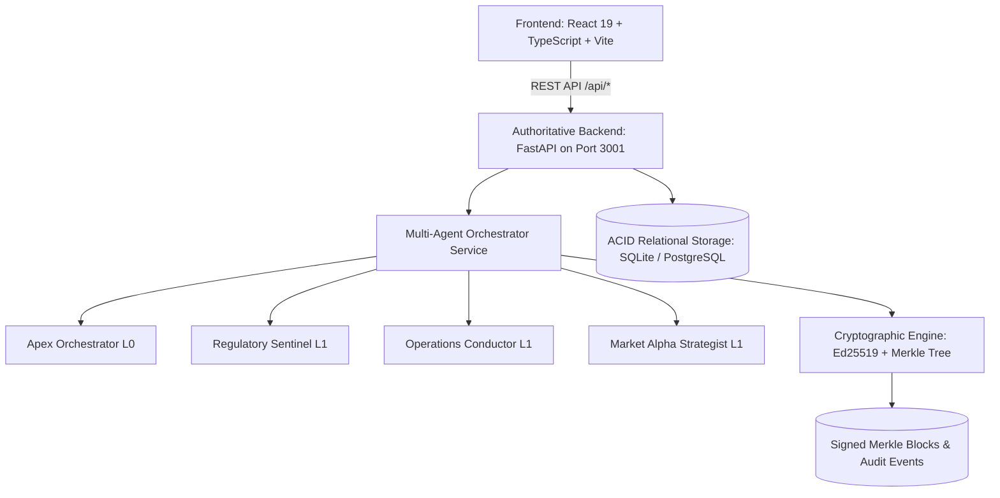

# AETHERIS AEOS (Autonomous Enterprise Operating System)

> **Next-Generation Multi-Agent Operations & Cryptographic Governance Platform**  
> Autonomous supply chain recovery, evidence-backed regulatory compliance, human-in-the-loop policy gates, and Ed25519-signed Merkle audit trails.

---

## 1. Executive Summary & Mission

AETHERIS AEOS transforms enterprise operations from reactive dashboard monitoring into an **authoritative, backend-driven autonomous execution engine**. Rather than relying on simulated UI mocks, AEOS coordinates specialized autonomous agents to detect operational deficits, validate legal/regulatory constraints, enforce human authorization thresholds, execute real procurement tools, verify resulting state directly against relational databases, and seal tamper-proof cryptographic proofs.

---

## 2. Core Architectural Pillars



### 1. Authoritative Backend (`server_py/`)
- **FastAPI / Python 3.14+** running on port `3001`.
- **SQLAlchemy 2.0 Relational Engine**: Relational schema tracking `organizations`, `users`, `products`, `inventory`, `orders`, `suppliers`, `purchase_orders`, `agent_runs`, `agent_tasks`, `approval_requests`, `compliance_documents`, `compliance_evaluations`, `audit_events`, and `merkle_blocks`.
- Local ACID persistence via `server_py/aetheris.db` (compatible with enterprise PostgreSQL via `DATABASE_URL`).

### 2. Required Operational Benchmark Scenario
- **Customer Order**: `ORD-2026-500` (Airbus Defense).
- **Required Quantity**: `500 units` of Titanium Flanges needed within **5 days**.
- **Physical Inventory**: `300 units` available in Munich Logistics Hub.
- **Calculated Deficit**: `200 units` shortage.
- **Supplier Arbitrage**:
  - *Bavaria Precision Metallics*: Lead time 3 days (compliant with 5-day SLA), Cost $54.00/unit = **$10,800.00**, CBAM Green Hydrogen certified, Composite score 94.2.
  - *Nordic Aerometals*: Lead time 7 days (violates 5-day SLA), Cost $49.00/unit = $9,800.00.
  - *Sino-Titanium Tech*: Subject to EAR99 cross-border export hold.
- **Policy Gate Enforcement**: The recommended action ($10,800) exceeds the autonomous authorization threshold ($5,000.00). The swarm pauses into `waiting_for_approval`.
- **RBAC & Authorization**: Approval requests require `operations_director` or `executive` authorization (analysts receive `HTTP 403 Forbidden`).
- **Independent Verification**: Once approved, PO `PO-2026-AUTO-01` executes, and the system verifies directly from the database that Munich inventory allocated = 500 units before completing the run.

### 3. Cryptographic Governance & Merkle DAG
- **Deterministic Canonical Serialization**: RFC 8785 compliant canonical JSON serialization.
- **SHA-256 Chaining**: Each task execution produces an event digest cryptographically linked to the previous event (`previous_event_hash`).
- **Binary Merkle Tree**: Leaf hashes computed as `SHA-256(0x00 || event_json)`. Internal nodes computed as `SHA-256(0x01 || left || right)`.
- **Ed25519 Digital Signatures**: Every sealed block is signed using Python's native `cryptography` Ed25519 private key.
- **Mathematical Inclusion Proofs**: Verified mathematically on demand with exact audit paths (`left`/`right` siblings).

---

## 3. Specialized Multi-Agent Swarm

| Agent Role | Codename | Layer | Core Function |
| :--- | :--- | :--- | :--- |
| **Orchestrator** | Apex Orchestrator | `L0` | Decomposes macro directives, arbitrates agent recommendations, detects shortages, and manages the execution pipeline. |
| **Compliance** | Regulatory Sentinel | `L1` | Ingests statutory feeds, checks EAR99 export controls, EU CBAM carbon tariffs, and German LkSG supply chain due diligence citing stored documents. |
| **Operations** | Operations Conductor | `L1` | Multi-modal dynamic logistics, vendor scorecards, shortage calculation, and automated purchase order execution. |
| **Competitive** | Market Alpha Strategist | `L1` | Real-time market intelligence, supplier price benchmark arbitrage, and contractual margin analysis. |
| **Auditor** | Cryptographic Auditor | `L2` | Constructs Merkle trees, generates inclusion proofs, signs state blocks with Ed25519, and verifies cryptographic integrity. |

---

## 4. Key Security Upgrades

1. **Elimination of Mock Cryptography**: Removed fake `Math.random()` pseudo-hashes. All digests are real SHA-256 digests; all digital signatures are real Ed25519 cryptographic signatures.
2. **Secure Password Hashing**: Replaced plain-text comparison with industry-standard bcrypt/PBKDF2.
3. **Database-Backed RBAC**: Roles (`executive`, `operations_director`, `analyst`, `compliance_officer`) enforced server-side via FastAPI dependency injection. Unauthorized approval attempts return `403 Forbidden` and log security audit events.
4. **Relational Data Integrity**: Foreign keys, ACID transactions, and deterministic schema migrations replace in-memory arrays.

---

## 5. Developer Quickstart

### Prerequisites
- Node.js 18+ and npm
- Python 3.10+ (tested on Python 3.14) with virtual environment or system Python

### 1. Install Dependencies
```bash
# Install frontend and root dependencies
npm install

# Install Python backend dependencies
pip install fastapi uvicorn sqlalchemy cryptography bcrypt pydantic
```

### 2. Run Comprehensive Test Suite
```bash
# Run backend architectural verification suite (100% PASS)
npm run test:py
```

### 3. Start Development Servers
```bash
# Option A: Start both API and Frontend concurrently
npm run dev:all

# Option B: Start services independently
npm run server     # Runs FastAPI on http://localhost:3001
npm run dev        # Runs Vite on http://localhost:5173 (proxies /api to 3001)
```

### 4. Build & Lint Verification
```bash
# Typecheck and production bundle build
npm run build

# Fast AST linter
npm run lint
```

---

## 6. Default Demo Credentials

| Name | Role | Email | Password |
| :--- | :--- | :--- | :--- |
| Elena Rostova | `executive` (CEO) | `elena@aetheris.ai` | `Executive2026!` |
| Marcus Vance | `operations_director` | `marcus@aetheris.ai` | `Operations2026!` |
| Sophia Chen | `compliance_officer` | `sophia@aetheris.ai` | `Compliance2026!` |
| Jordan Brooks | `analyst` | `jordan@aetheris.ai` | `Analyst2026!` |

---

## 7. Architecture & Provenance Documentation

- Detailed Architecture & Security Audit: [`docs/architecture-audit.md`](file:///d:/DEVLOPEMENT/2nd%20project/2nd%20project/docs/architecture-audit.md)
- Operational & Financial Metrics Catalog: [`docs/metrics-and-evidence.md`](file:///d:/DEVLOPEMENT/2nd%20project/2nd%20project/docs/metrics-and-evidence.md)
