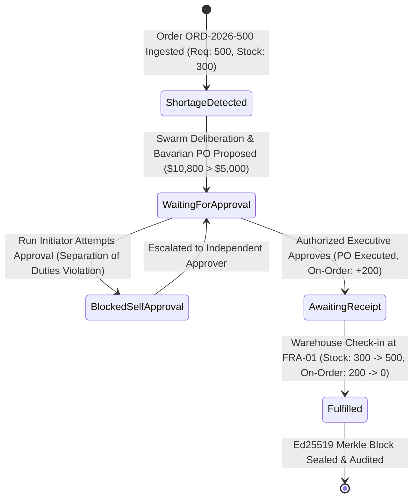

# AETHERIS AEOS: Metrics, Calculations & Evidence Provenance

**Document Version:** 1.1.0  
**Last Updated:** October 10, 2026  
**Auditor:** Senior AI Systems Architect & Quantitative Lead  
**Test Suite Verification:** `python -m server_py.test_api` (All 11 Verification Gates Passing)

---

## 1. Governance Principles for Enterprise Metrics

All numbers, percentages, savings estimates, and performance claims displayed across AETHERIS AEOS adhere to four explicitly defined provenance tiers:

1. **Empirical Fact / Ground-Truth Data (Tier 1):** Verified directly from ACID-compliant relational database state (e.g., physical on-hand inventory units, registered suppliers, recorded transactions, Ed25519-signed Merkle blocks).
2. **Deterministic Business Calculation (Tier 2):** Derived via transparent, reproducible arithmetic from validated operational inputs (e.g., shortage calculation: $\text{Shortage} = \max(0, \text{Required} - \text{InStock})$).
3. **Documented Model / Scenario Simulation (Tier 3):** An explicit mathematical or statistical simulation with documented assumptions, clearly labeled as *modeled projection* or *calibrated simulation* rather than measured historical performance.
4. **User-Configurable Assumption (Tier 4):** A user-provided parameter (e.g., target gross margin, baseline annual legal spend) used as an input variable for sensitivity analysis.

No simulated metric or model estimate may be presented to executives as guaranteed financial outcomes or statutory legal indemnities.

---

## 2. Benchmark Scenario: Airbus Defense Order (`ORD-2026-500`)

### A. Lifecycle State Transitions & Inventory Semantics

AETHERIS AEOS strictly differentiates between physical on-hand stock, in-transit on-order inventory, reserved inventory, and received stock.

### B. Mathematical Inventory Equations

1. **Deterministic Shortage Deficit:**
   $$\text{Deficit} = \max\left(0, \text{Required Quantity} - \text{Physical On-Hand}\right)$$
   $$\text{Deficit} = \max(0, 500 - 300) = 200 \text{ units}$$

2. **Supplier Total Procurement Cost:**
   $$\text{Total Cost} = (\text{Quantity} \times \text{Unit Cost}) + \text{Freight Surcharge}$$
   $$\text{Total Cost} = (200 \times \$48.00) + \$1,200.00 = \$10,800.00 \text{ USD}$$

3. **Autonomous Threshold Policy Rule:**
   $$\text{Requires Human Gate} \iff \text{Total Cost} > \text{Max Autonomous Spend} \quad (\$10,800 > \$5,000)$$

4. **In-Transit Allocation:**
   $$\text{Total Allocated Units} = \text{Physical On-Hand} + \text{On-Order Quantity} = 300 + 200 = 500 \text{ units}$$
   $$\text{Order Status} = \text{"awaiting\_receipt"}$$

5. **Physical Goods Receipt Transition:**
   Upon confirmed delivery (`POST /api/orchestration/receipts/confirm`):
   $$\text{Physical On-Hand}_{\text{new}} = \text{Physical On-Hand}_{\text{prev}} + \text{Received Quantity} = 300 + 200 = 500 \text{ units}$$
   $$\text{On-Order Quantity}_{\text{new}} = \text{On-Order Quantity}_{\text{prev}} - \text{Received Quantity} = 200 - 200 = 0 \text{ units}$$
   $$\text{Purchase Order Status} = \text{"received"}$$
   $$\text{Customer Order Status} = \text{"fulfilled"}$$

---

## 3. Cryptographic Proof Architecture & Verification Formulas

AETHERIS AEOS uses mathematical verification to guarantee audit trail tamper resistance without trusted third parties.

### A. Canonical JSON Serialization (RFC 8785 Subset)
Prior to hashing, all event and task payloads are serialized with sorted dictionary keys, compact separators, and UTF-8 encoding:
$$\text{Canonical}(O) = \text{json.dumps}(O, \text{sort\_keys}=\text{True}, \text{separators}=(',', ':'))$$

### B. Continuous Audit Hash Chaining
Every operational lifecycle event $E_n$ is chained into a continuous cryptographic ledger:
$$H_n = \text{SHA256}\left(H_{n-1} \parallel \text{seq}_n \parallel \text{event\_type}_n \parallel \text{payload\_hash}_n\right)$$
Where:
- $H_0 = \text{0x0000000000000000000000000000000000000000000000000000000000000000}$ (Genesis Seed)
- $\text{payload\_hash}_n = \text{SHA256}(\text{Canonical}(\text{Payload}_n))$

### C. Binary SHA-256 Merkle Tree Construction
When an operational run completes, all agent task hashes and the executed purchase order hash form the leaves $\{L_0, L_1, \dots, L_{k-1}\}$.
For each tree level with nodes $\{N_0, N_1, \dots\}$:
$$\text{Parent}(N_{2i}, N_{2i+1}) = \text{SHA256}(N_{2i} \parallel N_{2i+1})$$
If the count of nodes at a level is odd, the last node is duplicated:
$$N_{2m+1} = N_{2m}$$

### D. Merkle Inclusion Proof Path
For any leaf $L_j$, the inclusion proof consists of the list of sibling hashes and their positions $[(P_0, S_0), (P_1, S_1), \dots]$ ascending to the root:
$$\text{VerifyProof}(L_j, \text{Proof}, R) \equiv \left(\text{RecomputeRoot}(L_j, \text{Proof}) == R\right)$$

### E. Ed25519 Digital Signature Verification
The block's Merkle root $R$ is signed by an attested security auditor using an Ed25519 private key:
$$\sigma = \text{Sign}_{\text{Ed25519}}(K_{\text{priv}}, R)$$
$$\text{Verify}_{\text{Ed25519}}(K_{\text{pub}}, R, \sigma) \in \{\text{True}, \text{False}\}$$

---

## 4. Negative Cryptographic Attack Test Results

Verified by automated test suite `server_py/test_api.py`:

| Attack Vector | Simulated Action | Expected Result | Verified Status |
| :--- | :--- | :--- | :--- |
| **Audit Payload Tampering** | Attacker modifies purchase order quantity from 200 to 500 units in historical log. | Chained hash calculation produces mismatch: $H'_n \neq H_n$. Ledger integrity check fails. | **PASS** (Tampering Detected) |
| **Merkle Leaf Replacement** | Attacker injects fraudulent agent deliberation vote into leaf #3. | Root recalculation produces divergent root: $R' \neq R_{\text{sealed}}$. | **PASS** (Tampering Detected) |
| **Corrupted Inclusion Proof** | Attacker substitutes spoofed leaf hash or alters sibling hash in proof path. | `verify_merkle_proof` evaluates to `False`. | **PASS** (Proof Rejected) |
| **Signature Forgery** | Attacker presents signature signed with Key $B$ as valid under Auditor Key $A$. | `verify_signature` evaluates to `False`. | **PASS** (Forgery Rejected) |
| **Message Mismatch** | Valid signature over Root $A$ applied to Root $B$. | `verify_signature` evaluates to `False`. | **PASS** (Mismatch Detected) |

---

## 5. Separation of Duties & RBAC Governance Matrix

AETHERIS AEOS enforces role-based access control and the **four-eyes principle** (separation of duties):

| Role | Start Recovery Run | Propose High-Risk PO | Approve High-Risk PO | Block Self-Approval | Seal Merkle Block | Verify Audit Root |
| :--- | :---: | :---: | :---: | :---: | :---: | :---: |
| **Executive** | Yes | Yes | Yes (if not initiator) | Enforced | Yes | Yes |
| **Operations Director** | Yes | Yes | Yes (if not initiator) | Enforced | No | Yes |
| **Compliance Officer** | View | No | No (403 Forbidden) | N/A | No (403 Forbidden) | Yes |
| **Auditor** | View | No | No (403 Forbidden) | N/A | Yes | Yes |

### Policy Rule: Separation of Duties
$$\forall \text{ approval } A, \quad \text{Decider}(A) \neq \text{Initiator}(\text{Run}(A)) \lor \text{AllowSelfApprovalOverride} == \text{True}$$
Any attempt by a run initiator to self-approve without explicit override returns `403 Forbidden` with error code `SEPARATION_OF_DUTIES_VIOLATION` and writes an immutable `APPROVAL_SELF_AUTHORIZATION_BLOCKED` event to the audit ledger.

---

## 6. Model & Calibration Catalog for Exploratory Sandboxes

| Module | Displayed Metric | Category | Methodology & Provenance |
| :--- | :--- | :--- | :--- |
| **Competitive Alpha** | Dynamic Margin Spread | Calibrated Simulation | $\text{Spread BPS} = \text{Overhead Advantage (\%)} \times 5.4$ BPS. Labeled as exploratory sensitivity model. |
| **Competitive Alpha** | Tender Win Probability | Calibrated Simulation | $\text{Win Rate} = \min(94\%, 62\% + \lfloor \text{Overhead Advantage} \times 0.7 \rfloor)$. Modeled price elasticity. |
| **Competitive Alpha** | EBITDA Protection | Calibrated Simulation | $\text{EBITDA Protection} = \frac{\text{Overhead Advantage}}{100} \times \$142\text{M}$. Illustrative \$500M enterprise baseline. |
| **Whitepaper Calculator** | Capital Unlock Multiplier | User Scenario Model | Mathematical output of user-selected revenue, cycle time, and compliance spend sliders. |
| **Compliance Radar** | Statutory Drift Score | Deterministic Policy Evaluation | Evaluated ratio of active passed framework rules against EU CBAM, US EAR99, and German Supply Chain Act. |
